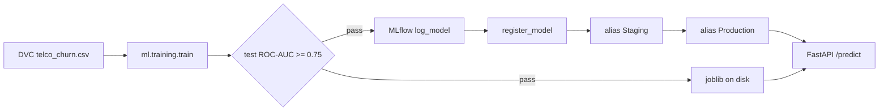

# MLflow — experiment tracking and model registry

One runbook for this project: **compare training runs** (tracking) and **promote deployable models** (registry). DVC still owns the training CSV; Git still owns code. MLflow owns run history, logged pipelines, and named versions.

**Audience:** Linux VM practice (MLflow **server** in `~/mlflow-setup`, separate venv). This repo is the **client**. Windows and macOS use the same environment variables; server install commands assume bash on Linux.

---

## At a glance

| Layer | Question it answers | Where it lives |
| --- | --- | --- |
| Git | Which code and config? | This repository |
| DVC | Which `telco_churn.csv` bytes? | `data/raw/telco_churn.csv.dvc` + remote |
| MLflow **tracking** | How did this run compare to the last ten? | Runs under experiment `customer-churn-xgboost` |
| MLflow **artifacts** | Which sklearn pipeline was produced on that run? | `sklearn_pipeline` on the run |
| MLflow **registry** | Which version is allowed in production? | `customer-churn-xgboost` `@Staging` / `@Production` |

```text
  ~/mlflow-setup/                         MLflow server (tracking + registry)
       sqlite:///mlflow.db                 run metadata, model versions, aliases
       ./mlartifacts/                     logged models (or s3://… in production)
       :5000                               UI + REST API

  ~/customer_churn_predition/             client (train + API)
       MLFLOW_TRACKING_URI=http://127.0.0.1:5000
       python -m ml.training.train        → log run + artifact; register → Staging
       MLFLOW_MODEL_URI=models:/customer-churn-xgboost@Production
       uvicorn api.main:app               → optional registry-based serving
```

The open-source server has **no login**. Do not expose port 5000 to the internet. Prefer `127.0.0.1` for training on the same host; use an **SSH tunnel** or a security group limited to your IP for the UI.

---

<details>
<summary><strong>Shared setup — install and run the MLflow server (do this once)</strong></summary>

Use a directory **outside** this Git repo. Do **not** install the server into `customer_churn_predition/.venv`.

```bash
mkdir -p ~/mlflow-setup
cd ~/mlflow-setup

python3 -m venv .venv
source .venv/bin/activate
pip install -U pip
pip install mlflow

mlflow --version
mlflow db upgrade sqlite:///mlflow.db
```

Start the server (one process is enough; SQLite allows one writer):

```bash
cd ~/mlflow-setup
source .venv/bin/activate

mlflow server \
  --backend-store-uri sqlite:///mlflow.db \
  --default-artifact-root ./mlartifacts \
  --host 0.0.0.0 \
  --port 5000 \
  --workers 1 \
  --allowed-hosts '*'
```

| Flag | Purpose |
| --- | --- |
| `--backend-store-uri` | Runs, params, metrics, registry metadata |
| `--default-artifact-root` | Logged `sklearn_pipeline` and JSON artifacts |
| `--host 0.0.0.0` | Listen on all interfaces (only if you need the VM public IP in a browser) |
| `--allowed-hosts '*'` | Avoids `Invalid Host header` on recent MLflow |

**Survive SSH disconnect:**

```bash
cd ~/mlflow-setup && source .venv/bin/activate
nohup mlflow server \
  --backend-store-uri sqlite:///mlflow.db \
  --default-artifact-root ./mlartifacts \
  --host 0.0.0.0 --port 5000 --workers 1 --allowed-hosts '*' \
  > mlflow-server.log 2>&1 &
```

**Verify:**

```bash
sudo ss -tulpn | grep 5000
curl -s -o /dev/null -w "%{http_code}\n" http://127.0.0.1:5000
```

**Open the UI**

- On the VM: `http://127.0.0.1:5000`
- From a laptop without opening port 5000 publicly:

```bash
ssh -L 5000:127.0.0.1:5000 ubuntu@<VM-PUBLIC-IP>
```

Then browse `http://127.0.0.1:5000` locally.

**Production-style artifact root (reference only)**

```bash
mlflow server \
  --backend-store-uri sqlite:///mlflow.db \
  --default-artifact-root s3://YOUR-BUCKET/mlflow-artifacts \
  --host 127.0.0.1 \
  --port 5000
```

Requires S3 IAM on the prefix and credentials on the train/API hosts. Later, replace SQLite with PostgreSQL for concurrent writers.

Do **not** commit `mlruns/`, `mlflow.db`, or `~/mlflow-setup`.

</details>

---

<details>
<summary><strong>Shared setup — point this repo at the server and train</strong></summary>

Server must be listening. Use a **second** terminal with the **project** venv:

```bash
cd ~/customer_churn_predition
source .venv/bin/activate

export MLFLOW_TRACKING_URI=http://127.0.0.1:5000
echo "$MLFLOW_TRACKING_URI"

# Training CSV (pick one)
dvc pull                              # if DVC remote is configured
# or: python3 -m ml.data.generate

python3 -m ml.training.train
# or: dvc repro
```

Optional persistence on the VM only:

```bash
# ~/.bashrc
export MLFLOW_TRACKING_URI=http://127.0.0.1:5000
```

Fall back to local file store (no shared history on the VM):

```bash
unset MLFLOW_TRACKING_URI
```

Training reads **`MLFLOW_TRACKING_URI` from the environment**, not from `.env`, unless you export it (`set -a; source .env`). See `.env.example`.

**Smoke test** (after server is up):

```bash
export MLFLOW_TRACKING_URI=http://127.0.0.1:5000
python3 - <<'PY'
import mlflow
mlflow.set_experiment("demo-experiment")
with mlflow.start_run():
    mlflow.log_param("learning_rate", 0.01)
    mlflow.log_metric("accuracy", 0.95)
print("ok")
PY
```

Confirm **demo-experiment** in the UI, then train for **customer-churn-xgboost**.

</details>

---

<details>
<summary><strong>Part 1 — Experiment tracking (compare runs)</strong></summary>

### Why tracking matters

Each `python -m ml.training.train` overwrites `artifacts/metrics/metrics.json` on disk. Without MLflow you cannot reliably answer:

- Which `learning_rate` / `max_depth` gave the best `test_roc_auc`?
- Was the run trained on the same CSV DVC froze (`dataset_sha256`)?
- Did recall change when the threshold changed?

Tracking is the audit log of **model development**; Git is the audit log of **code**.

### What this repo logs (client code)

`ml/training/train.py` and `ml/mlflow_utils.py`:

1. Resolve URI: **`MLFLOW_TRACKING_URI`** → else `configs/config.yaml` → `mlflow.tracking_uri` (`mlruns` = local file store).
2. HTTP(S) → remote server; otherwise `./mlruns/`.
3. Experiment: **`customer-churn-xgboost`**; run name: **`xgboost_churn`**.
4. Tags: `dataset_path`, `dataset_sha256`; params from config; validation and test metrics.
5. Artifacts: `metrics.json`, `feature_importance.json`, logged **`sklearn_pipeline`**.

Registry steps run only after the quality gate passes and only with an HTTP(S) tracking URI (see Part 2).

### Compare experiments in the UI

1. Open the UI → experiment **`customer-churn-xgboost`**.
2. Change **one** thing (e.g. `model.params` in `configs/config.yaml`; keep `params.yaml` in sync if you use `dvc repro`).
3. Train again with `MLFLOW_TRACKING_URI` set.
4. Select two runs → **Compare** → sort by `test_roc_auc` or `test_recall`.

| Field | Meaning |
| --- | --- |
| Params (`max_depth`, `learning_rate`, …) | What you changed |
| `threshold` | Cutoff used when metrics were computed |
| `test_*` | Held-out test set (use for gate and final choice) |
| `val_*` | Tuning signal; avoid repeated test peeking |
| Tag `dataset_sha256` | Hash of training file; should match DVC freeze if CSV unchanged |
| Artifacts | Metrics JSON, importance, full pipeline |

**Workflow habits**

1. Freeze data (`dvc pull` / known `.dvc` md5); do not regenerate CSV between comparison runs.
2. Change one variable per run, or add a tag such as `hypothesis=deeper_trees`.
3. Pick winners using **test** metrics and the gate (`roc_auc >= 0.75`), not training loss.

### Tracking-only notes

- Separate **server venv** and **project venv**; keep MLflow versions aligned when possible.
- Do not log secrets as params.
- `Unable to locate credentials` during train is usually **DVC/S3**, not MLflow.

</details>

---

<details>
<summary><strong>Part 2 — Model registry, artifacts, and serving</strong></summary>

### Tracking vs registry vs artifacts

| Concern | MLflow piece | This project |
| --- | --- | --- |
| Run history | **Tracking** | Params, metrics, tags per train |
| Model binary on a run | **Artifact** | `sklearn_pipeline` (features + XGBoost) |
| Approved deployable | **Registry** | `customer-churn-xgboost` version + alias |

- Tracking: *“How did this run compare?”*
- Registry: *“Which model may serve production traffic right now?”*

Industry flow:

1. Train → log metrics + artifact on the run.
2. Quality gate passes → **register** a new version.
3. Auto-set alias **Staging** (config); **Production** only after human or release CI review.
4. API loads `models:/<name>@Production` (or a pinned version), not an unversioned path.

This repo still writes **`artifacts/models/churn_pipeline.joblib`** for local/Docker and DVC `outs`. Treat the registry as the system of record for **promoted** models.



**Registration requires HTTP(S)** `MLFLOW_TRACKING_URI`. Local `./mlruns` still logs runs for learning; automation **skips** registry with a clear message.

### Configuration (`configs/config.yaml`)

```yaml
mlflow:
  tracking_uri: mlruns
  experiment_name: customer-churn-xgboost
  model_uri: null   # or models:/customer-churn-xgboost@Production
  registry:
    enabled: true
    registered_model_name: customer-churn-xgboost
    logged_model_name: sklearn_pipeline
    promote_alias_on_pass: Staging
```

| Setting | Meaning |
| --- | --- |
| `registered_model_name` | Registry entity |
| `logged_model_name` | Must match `mlflow.sklearn.log_model` name in `ml/mlflow_utils.py` |
| `promote_alias_on_pass` | Alias after register (default **Staging**); empty = register only |
| `model_uri` | Default API source if `MLFLOW_MODEL_URI` unset |

| Environment variable | Purpose |
| --- | --- |
| `MLFLOW_TRACKING_URI` | Tracking + registry API (train and load) |
| `MLFLOW_MODEL_URI` | Serving, e.g. `models:/customer-churn-xgboost@Production` |
| `MLFLOW_REGISTER_MODEL=false` | Log runs without new registry versions |

### After a successful train

1. **Disk:** `churn_pipeline.joblib`, `metadata.json`.
2. **Run:** params, metrics, tags, artifacts including `sklearn_pipeline`.
3. **Registry:** new version on `customer-churn-xgboost`, alias **Staging** (if configured).

`metadata.json` may include `mlflow_run_id`, `mlflow_registered_model`, `mlflow_model_version`, `mlflow_model_uri`, `mlflow_model_alias`.

Artifacts on disk learning layout:

`~/mlflow-setup/mlartifacts/<experiment_id>/<run_id>/artifacts/sklearn_pipeline/`

### Promote Staging → Production (manual gate)

**UI:** Models → `customer-churn-xgboost` → version on **Staging** → set alias **Production**.

**CLI:**

```bash
export MLFLOW_TRACKING_URI=http://127.0.0.1:5000

python3 - <<'PY'
from mlflow import MlflowClient

client = MlflowClient()
name = "customer-churn-xgboost"
version = "2"  # version you reviewed
client.set_registered_model_alias(name=name, alias="Production", version=version)
print("Production → version", version)
PY
```

Record the version and run tag `dataset_sha256` in your change record.

### Serve from the registry

```bash
export MLFLOW_TRACKING_URI=http://127.0.0.1:5000
export MLFLOW_MODEL_URI=models:/customer-churn-xgboost@Production

uvicorn api.main:app --host 0.0.0.0 --port 8000
```

```bash
curl -s http://127.0.0.1:8000/health | python3 -m json.tool
```

Expect `model_source: "mlflow_registry"` and `model_uri` matching `MLFLOW_MODEL_URI`.

**Default serving** (no env): `artifacts/models/churn_pipeline.joblib` via `ml/serving/predictor.py`.

**Docker:** `mlops/docker-compose.yml` mounts local `artifacts/`. For registry serving, pass `MLFLOW_TRACKING_URI` and `MLFLOW_MODEL_URI` in `environment` and ensure the container can reach the server and artifact store (S3 credentials if applicable).

**Kubernetes (KServe):** recommended **Path A** in **[kserve_serving.md](kserve_serving.md#quick-runbook--path-a-registry--s3-on-ec2)** — registry + S3 Secret + `inference-service-kind.yaml`. If artifacts are on `s3://`, the serving pod needs AWS creds (same as training).

</details>

---

<details>
<summary><strong>Git + DVC + MLflow — who owns what</strong></summary>

| Action | Git | DVC / S3 | MLflow |
| --- | --- | --- | --- |
| Change hyperparameters | commit `configs/config.yaml` | — | new run |
| New training CSV | commit `.dvc` pointer | `dvc push` CSV | tag `dataset_sha256` |
| New model after `dvc repro` | `dvc.lock` | optional `dvc push` outs | register + alias |
| Deploy to prod | release / PR | `dvc pull` if using disk artifact | **Production** alias |

Do not manually upload `churn_pipeline.joblib` to S3 if DVC or MLflow already versions it—pick one primary path per environment.

</details>

---

<details>
<summary><strong>Best practices checklist</strong></summary>

- [ ] MLflow server on HTTP(S); artifacts on durable storage (disk for lab, S3 for team).
- [ ] Train after data freeze (`dvc pull` + known `.dvc` md5).
- [ ] Quality gate on **test** set before treating a run as release-ready (`roc_auc >= 0.75`).
- [ ] Auto-alias **Staging** only; **Production** promoted manually or by release CI.
- [ ] Serving uses `models:/...@Production` or pinned `models:/name/version` for audits.
- [ ] Never commit `mlruns/`, `mlflow.db`, or `~/mlflow-setup`.
- [ ] Never log secrets as MLflow params.
- [ ] Restrict port 5000 or use SSH tunnel; bind `127.0.0.1` when possible.
- [ ] Align `params.yaml` with `configs/config.yaml` when using `dvc repro`.
- [ ] Separate server and project virtualenvs; keep MLflow versions in sync.

</details>

---

<details>
<summary><strong>Troubleshooting — experiment tracking</strong></summary>

| Symptom | Likely cause | Fix |
| --- | --- | --- |
| Runs under `customer_churn_predition/mlruns` | `MLFLOW_TRACKING_URI` unset | `export MLFLOW_TRACKING_URI=http://127.0.0.1:5000` and retrain |
| Connection refused | Server down | Start server; `curl` port 5000 |
| `Invalid Host header` | Missing allowed hosts | Restart with `--allowed-hosts '*'` |
| UI empty after train | Wrong experiment or file store | Confirm experiment name; check URI |
| Runs search `INTERNAL_ERROR` | Filter uses unknown metrics/params | Clear filter; try `metrics.test_roc_auc > 0.75` |
| Model logging skipped / untrusted types | Skops trust list | Use current `ml/training/train.py`; joblib on disk still updates |
| Quality gate fails | Metrics below bar | Tracking still logged; fix model/data first |
| `MLflow tracking skipped: No module named 'boto3'` | Server artifact root is `s3://…` or client uploads to S3 | `pip install boto3`; configure AWS creds, or use `--default-artifact-root ./mlartifacts` on the server |
| Run appears in UI but no model / no registry | Artifact or `log_model` failed inside the run | Fix boto3/S3; retrain; check train stderr for `model logging skipped` |

</details>

---

<details>
<summary><strong>Troubleshooting — model registry and serving</strong></summary>

| Symptom | Likely cause | Fix |
| --- | --- | --- |
| Registry skipped: use HTTP(S) server | Logging to `./mlruns` | Set tracking URI to server and retrain |
| Registry skipped after exception | Server, permissions, name mismatch | Server logs; verify `logged_model_name` |
| API loads old joblib | No `MLFLOW_MODEL_URI` | Export URI or set `mlflow.model_uri` |
| `Unable to download model artifacts` | API cannot reach artifact store | S3 creds; network from container |
| Too many registry versions | Every train registers | `MLFLOW_REGISTER_MODEL=false` for experiments |
| Health shows `local_artifact` | Registry URI not set | Set `MLFLOW_MODEL_URI` |
| Staging ≠ Production | Expected | Only Production backs prod traffic |

</details>

---

<details>
<summary><strong>CI/CD direction (not fully wired in this repo)</strong></summary>

Typical `.github/workflows/` evolution:

1. `dvc pull` (secrets for remote).
2. `export MLFLOW_TRACKING_URI=...` (internal server).
3. `dvc repro` or `python -m ml.training.train`.
4. Fail if quality gate fails.
5. Register + alias **Staging** on `main` or `workflow_dispatch`.
6. Separate approval job to set **Production**.

Keep fast `pytest` on every PR; full train on protected branches or manual dispatch.

</details>

---

## Quick reference

| Goal | Command / setting |
| --- | --- |
| Log runs to shared server | `export MLFLOW_TRACKING_URI=http://127.0.0.1:5000` |
| Train | `python3 -m ml.training.train` or `dvc repro` |
| Compare runs | UI → `customer-churn-xgboost` → Compare |
| Serve local artifact | `uvicorn api.main:app` (default joblib path) |
| Serve production model | `MLFLOW_MODEL_URI=models:/customer-churn-xgboost@Production` |
| Skip registry on experiments | `MLFLOW_REGISTER_MODEL=false` |

## Related

- [dvc_setup.md](dvc_setup.md) — dataset versioning and `dvc repro`
- `configs/config.yaml` — `mlflow.*` and `model.*`
- `ml/mlflow_utils.py` — URI resolution, log, register
- `ml/training/train.py` — train, gate, registry hook
- `ml/serving/predictor.py` — joblib vs registry load
- [MLflow tracking](https://mlflow.org/docs/latest/tracking.html)
- [MLflow Model Registry](https://mlflow.org/docs/latest/model-registry.html)
