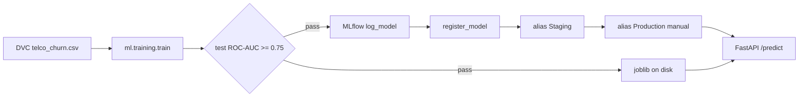

# MLflow model artifacts and registry — runbook

This guide covers **artifact storage** (logged sklearn pipelines per run) and the **Model Registry** (named versions, aliases such as `Staging` and `Production`). It complements experiment tracking in [mlflow_tracking.md](mlflow_tracking.md) and dataset versioning in [dvc_setup.md](dvc_setup.md).

**Audience:** Linux VM practice (MLflow server outside this repo). Windows/macOS clients follow the same env vars.

---

## 1. Why artifacts and registry are separate from tracking

| Concern | Tool | What you store |
| --- | --- | --- |
| Code + pipeline definition | Git + `dvc.yaml` | Reviewable train graph |
| Training table bytes | DVC + S3 | `telco_churn.csv` pointer |
| Experiment history | MLflow Tracking | Params, metrics, tags per run |
| **Model binaries** | MLflow **Artifacts** | `sklearn_pipeline` (features + XGBoost) |
| **Approved deployable** | MLflow **Registry** | `customer-churn-xgboost` v3 `@Production` |

Tracking answers: *“How did this run compare?”*  
Registry answers: *“Which model is allowed in production right now?”*

Industry pattern:

1. Train → log metrics + **artifact** on the run.
2. Quality gate passes → **register** a new model version.
3. Human or CI promotes **Staging** → **Production** (do not auto-promote Production from a laptop script unless policy allows it).
4. Serving loads `models:/<name>@Production` (or a pinned version), not an unversioned path on disk.

This repo still writes `artifacts/models/churn_pipeline.joblib` for local/Docker convenience and DVC `outs`. The registry is the **system of record** for promoted models.

---

## 2. Architecture

```text
  ~/mlflow-setup/                    MLflow tracking + registry server
       sqlite:///mlflow.db           metadata (runs, versions, aliases)
       ./mlartifacts/                OR s3://bucket/mlflow-artifacts/
       :5000

  customer_churn_predition/          client (train + API)
       MLFLOW_TRACKING_URI=http://127.0.0.1:5000
       python -m ml.training.train   → log artifact + register + alias Staging
       MLFLOW_MODEL_URI=models:/customer-churn-xgboost@Production
       uvicorn api.main:app          → load from registry
```



**Default serving:** local joblib (`artifacts/models/churn_pipeline.joblib`).  
**Registry serving:** set `MLFLOW_MODEL_URI` or `mlflow.model_uri` in `configs/config.yaml`.

---

## 3. Prerequisites

1. MLflow tracking server running (see [mlflow_tracking.md](mlflow_tracking.md) §3).
2. Training CSV present (`dvc pull` or `python -m ml.data.generate`).
3. Project venv: `pip install -r requirements.txt`.
4. `export MLFLOW_TRACKING_URI=http://127.0.0.1:5000` before train and before API if loading from registry.

Registry **registration** requires an **HTTP(S)** tracking URI. Local file store (`./mlruns`) logs runs for learning but **does not** register models from this project’s automation (the code skips registry with a clear message).

---

## 4. Server setup for artifacts (VM learning)

### 4.1 Local artifact root (default learning)

Use the same server command as tracking:

```bash
cd ~/mlflow-setup
source .venv/bin/activate

mlflow server \
  --backend-store-uri sqlite:///mlflow.db \
  --default-artifact-root ./mlartifacts \
  --host 0.0.0.0 \
  --port 5000 \
  --workers 1 \
  --allowed-hosts '*'
```

Artifacts land under `~/mlflow-setup/mlartifacts/<experiment_id>/<run_id>/artifacts/sklearn_pipeline/`.

### 4.2 Production-style artifact root (S3)

For teams and interviews, cite this pattern even if you keep files on disk while learning:

```bash
mlflow server \
  --backend-store-uri sqlite:///mlflow.db \
  --default-artifact-root s3://YOUR-BUCKET/mlflow-artifacts \
  --host 127.0.0.1 \
  --port 5000
```

Requirements:

- IAM: `s3:PutObject`, `s3:GetObject`, `s3:ListBucket` on that prefix.
- Same credentials for training client and API host (`aws configure` or instance role).
- Later: PostgreSQL `--backend-store-uri` instead of SQLite for concurrent writers.

**Security:** bind to `127.0.0.1` + SSH tunnel, or restrict security group to your IP. The open-source server has **no authentication**.

---

## 5. Configuration in this repository

`configs/config.yaml`:

```yaml
mlflow:
  tracking_uri: mlruns
  experiment_name: customer-churn-xgboost
  model_uri: null   # or models:/customer-churn-xgboost@Production
  registry:
    enabled: true
    registered_model_name: customer-churn-xgboost
    logged_model_name: sklearn_pipeline
    promote_alias_on_pass: Staging
```

| Setting | Meaning |
| --- | --- |
| `registered_model_name` | Registry entity (one per product/model line). |
| `logged_model_name` | Must match `mlflow.sklearn.log_model` name in `ml/mlflow_utils.py`. |
| `promote_alias_on_pass` | After gate + register, set alias (default **Staging**). Leave empty to register only. |
| `model_uri` | Optional default for API when `MLFLOW_MODEL_URI` is unset. |

Environment overrides (`.env.example`):

| Variable | Purpose |
| --- | --- |
| `MLFLOW_TRACKING_URI` | Tracking + registry API (train and load). |
| `MLFLOW_MODEL_URI` | Serving source, e.g. `models:/customer-churn-xgboost@Production`. |
| `MLFLOW_REGISTER_MODEL=false` | Log runs/artifacts without new registry versions. |

---

## 6. Train → artifact → register (automated path)

From repo root, server running:

```bash
cd ~/customer_churn_predition
source .venv/bin/activate
export MLFLOW_TRACKING_URI=http://127.0.0.1:5000

dvc pull    # optional, if using remote data
python3 -m ml.training.train
# or: dvc repro
```

After a successful run (quality gate **passed**):

1. **Disk:** `artifacts/models/churn_pipeline.joblib`, updated `metadata.json`.
2. **MLflow run:** params, metrics, tags (`dataset_sha256`), artifacts `metrics.json`, `feature_importance.json`, logged `sklearn_pipeline`.
3. **Registry:** new version under `customer-churn-xgboost`, alias **Staging** on that version (if `promote_alias_on_pass: Staging`).

`metadata.json` gains (when registration succeeds):

- `mlflow_run_id`
- `mlflow_registered_model`
- `mlflow_model_version`
- `mlflow_model_uri` (e.g. `models:/customer-churn-xgboost@Staging`)
- `mlflow_model_alias` when an alias was set

Implementation: `ml/mlflow_utils.py`, called from `ml/training/train.py`.

---

## 7. Promote Staging → Production (manual gate)

**Best practice:** Production is a deliberate promotion after review (metrics, data hash, stakeholder sign-off)—not every successful train.

### 7.1 UI

1. Open `http://127.0.0.1:5000` (or SSH tunnel).
2. **Models** → `customer-churn-xgboost`.
3. Open the version on **Staging** (aliases column).
4. **Set alias** → add or move **Production** to that version (or use **Promote** if your MLflow version shows stages migrated to aliases).

### 7.2 CLI

```bash
export MLFLOW_TRACKING_URI=http://127.0.0.1:5000

python3 - <<'PY'
from mlflow import MlflowClient

client = MlflowClient()
name = "customer-churn-xgboost"
version = "2"  # replace with the version you reviewed
client.set_registered_model_alias(name=name, alias="Production", version=version)
print("Production now points to version", version)
PY
```

Document the version and `dataset_sha256` tag from the source run in your change ticket.

---

## 8. Serve from the registry

### 8.1 API (recommended practice path)

```bash
export MLFLOW_TRACKING_URI=http://127.0.0.1:5000
export MLFLOW_MODEL_URI=models:/customer-churn-xgboost@Production

uvicorn api.main:app --host 0.0.0.0 --port 8000
```

Check:

```bash
curl -s http://127.0.0.1:8000/health | python3 -m json.tool
```

Expect `model_source: "mlflow_registry"` and `model_uri` matching `MLFLOW_MODEL_URI`.

### 8.2 Config-only (no env)

Set in `configs/config.yaml`:

```yaml
mlflow:
  model_uri: models:/customer-churn-xgboost@Production
```

Restart the API. Prefer **env** in real deployments so the same image can point at different aliases per environment.

### 8.3 Docker note

`mlops/docker-compose.yml` mounts `../artifacts` for the **local joblib** path. To serve from registry in Docker:

- Pass `MLFLOW_TRACKING_URI` and `MLFLOW_MODEL_URI` in compose `environment`.
- Ensure the container can reach the tracking server (network / host gateway).
- Or bake a joblib after `dvc pull` + train for offline demos.

---

## 9. How the three stores work together

| Action | Git | DVC/S3 | MLflow |
| --- | --- | --- | --- |
| Change hyperparameters | commit `configs/config.yaml` | — | new run |
| New training CSV | commit `.dvc` pointer | `dvc push` CSV | tag `dataset_sha256` on run |
| New model file | `dvc.lock` after `dvc repro` | optional `dvc push` outs | register version + alias |
| Deploy to prod | release tag / PR | `dvc pull` if using disk artifact | **Production** alias |

Do **not** upload `churn_pipeline.joblib` to S3 manually if DVC or MLflow already version it—pick one primary path per environment.

---

## 10. Best practices checklist

- [ ] Tracking server on HTTP(S); artifacts on durable storage (disk for lab, S3 for team).
- [ ] Train only after data freeze (`dvc pull` + known `.dvc` md5).
- [ ] Quality gate on **test** set before register (`roc_auc >= 0.75` in code).
- [ ] Auto-alias **Staging** only; **Production** promoted manually or by release CI.
- [ ] Serving uses `models:/...@Production` or pinned `models:/name/version` for audits.
- [ ] Never commit `mlruns/`, `mlflow.db`, or `~/mlflow-setup`.
- [ ] Never log secrets as MLflow params.
- [ ] Restrict port 5000; use SSH tunnel or private network.
- [ ] Align `params.yaml` with `configs/config.yaml` when using `dvc repro`.

---

## 11. Troubleshooting

| Symptom | Likely cause | Fix |
| --- | --- | --- |
| `Model registry skipped: use an HTTP(S) tracking server` | `MLFLOW_TRACKING_URI` unset; logging to `./mlruns` | Export server URI and retrain |
| `MLflow model registry skipped: ...` after exception | Permission, name mismatch, server down | Check server logs; verify `logged_model_name` |
| API still loads old joblib | `MLFLOW_MODEL_URI` unset | Export URI or set `mlflow.model_uri` |
| `Unable to download model artifacts` | API cannot reach artifact store | S3 credentials; server URL from container |
| New version every train clutters registry | Expected in dev | Use `MLFLOW_REGISTER_MODEL=false` for experiments; register only on release branches in CI |
| Staging and Production differ | Correct | Only Production should back customer-facing traffic |
| Health shows `local_artifact` | Registry URI not set | Set `MLFLOW_MODEL_URI` |

---

## 12. CI/CD direction (not fully wired in this repo)

Typical next step for `.github/workflows/`:

1. `dvc pull` training data (secrets for remote).
2. `export MLFLOW_TRACKING_URI=...` (internal server).
3. `dvc repro` or `python -m ml.training.train`.
4. Fail job if quality gate fails.
5. Register + alias **Staging** automatically.
6. Separate **approval** job or manual workflow to set **Production**.

Keep fast `pytest` on every PR; full train on `main` or `workflow_dispatch`.

---

## Related

- [mlflow_tracking.md](mlflow_tracking.md) — install server, compare runs
- [dvc_setup.md](dvc_setup.md) — dataset + `dvc repro` model outs
- `ml/mlflow_utils.py` — tracking URI, log, register
- `ml/training/train.py` — train + gate + registry hook
- `ml/serving/predictor.py` — joblib vs registry load
- [MLflow Model Registry](https://mlflow.org/docs/latest/model-registry.html)
